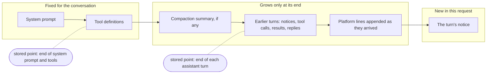
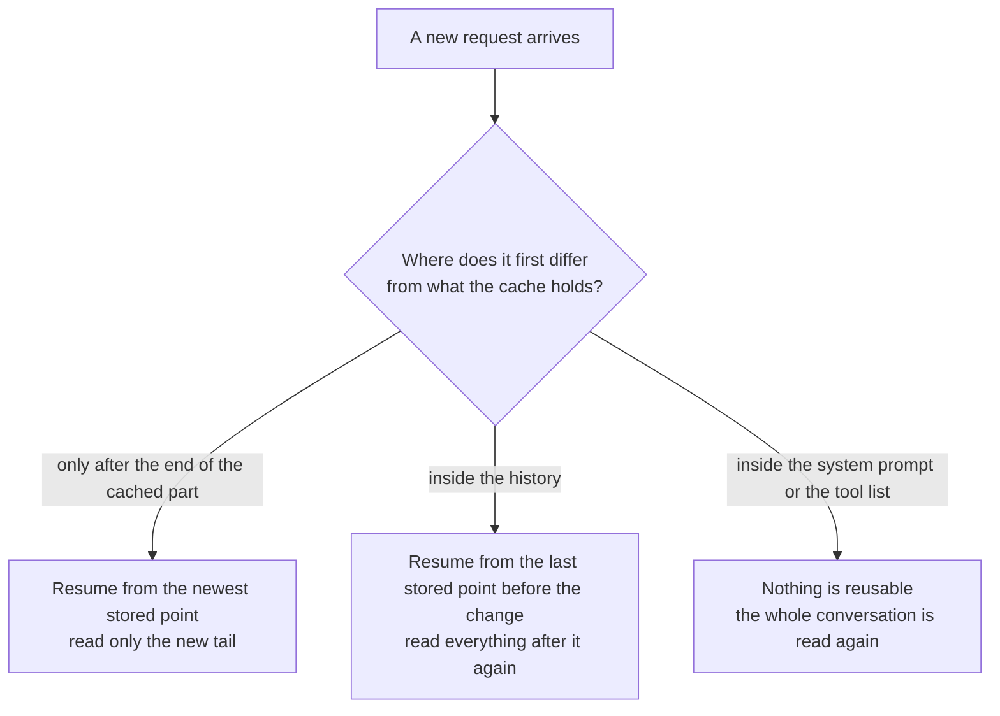
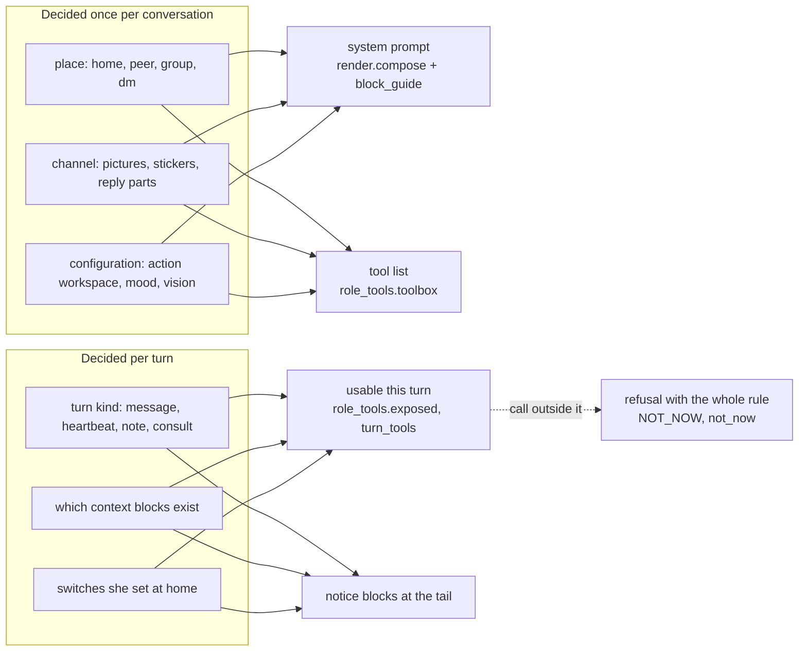
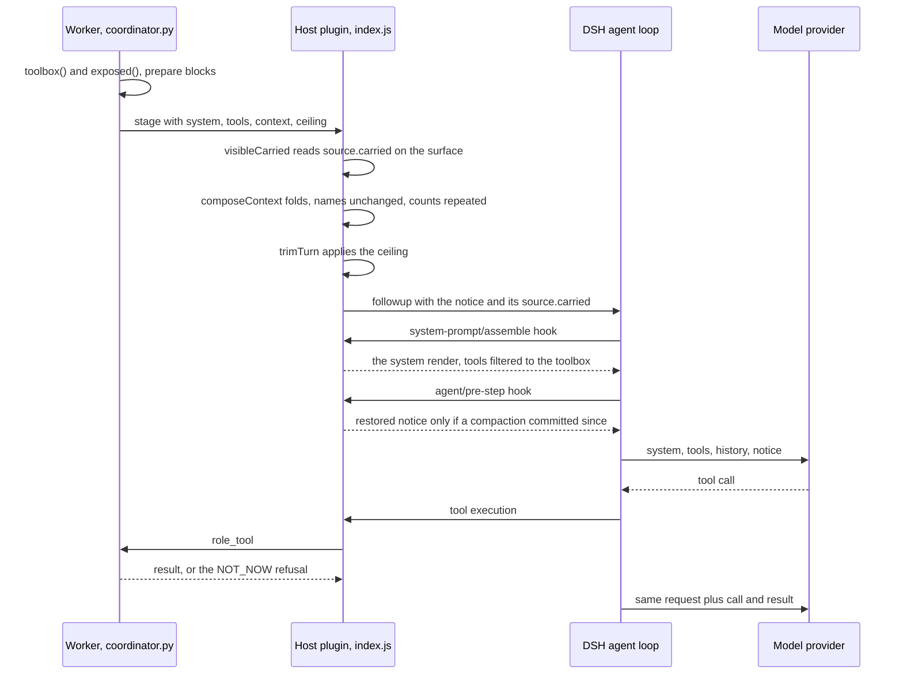
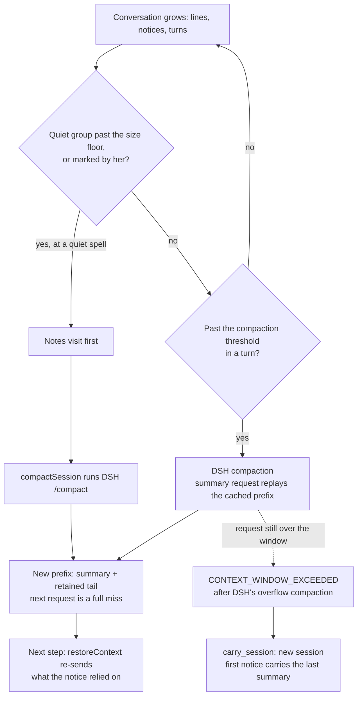
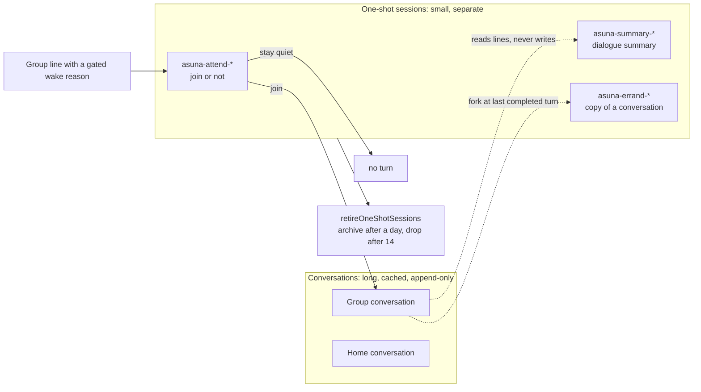
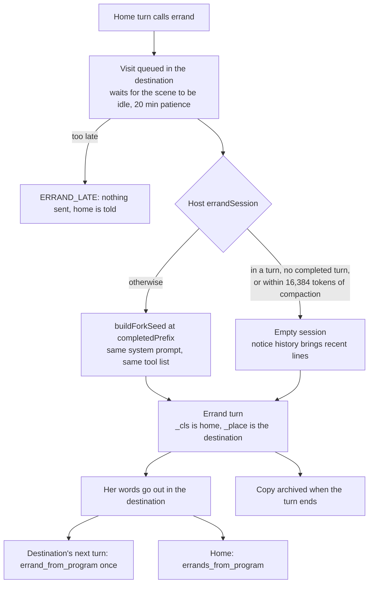
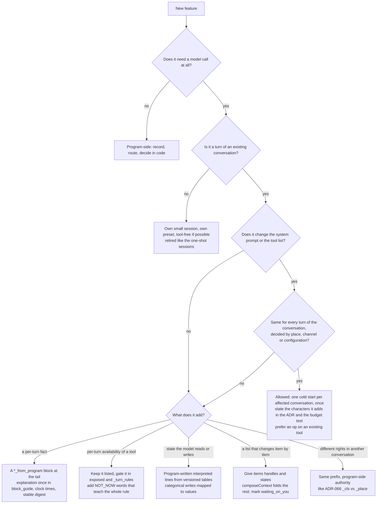

# Maximize Cache Hit By Design

> **Slug:** `maximize-cache-hit-by-design` — this file's own name, written here so it is greppable.
> **Status:** a living description of how the system is built today. Decisions and open questions live in the ADRs cited in §13, not here.
> **Added:** 2026-10-15, written by Claude at the owner's direction from the owner's design intent, with field evidence from the character's own runs (see ADR-038, ADR-049, ADR-056).

This article is for engineers and coding agents who extend Asuna: the character "cognition core" that runs as a
plugin on the DSH agent runtime, with a character brain (who speaks) and an action brain (who does the work). It
explains why the system is shaped around the model provider's prefix cache, how each mechanism works in the code, and
which rule to follow when you add something. The aim is that you design a new feature cache-first without having to
be told.

The short version:

1. A request is cheap only when it starts with exactly the bytes of a request the provider has already read.
2. So whatever is decided per conversation goes first and never changes; whatever is decided per turn goes last.
3. The system prompt and the tool list are per conversation. The turn's own rules are applied by the program
   (refusals), and the turn's own facts are text at the end of the turn's message.
4. The program sends only what the conversation no longer shows, and keeps the conversation small enough that the
   cache can hold it. A quiet conversation is condensed while its cache has lapsed anyway, so the reset costs nothing
   and the next cold read is a small one.
5. Work that is not the conversation (a yes/no gate, a summary) runs in its own small session so it does not disturb
   the conversation's cached prefix.

Nothing here is tuned to one model or one provider. Prefix caching works the same way at hosted APIs (DeepSeek, any
OpenAI-compatible endpoint) and at a local model server. Local-server figures appear below as illustrations because
they make the costs visible; they are not the design target.

---

## 1. How a prefix cache works

A chat request is one long sequence of tokens: the system prompt, the tool definitions, the conversation so far, and
the new message. To answer it, the model must first read ("prefill") all of it. A prefix cache keeps the model's
internal state for sequences it has already read, so a later request that *starts with the same tokens* can skip
reading that part again.

Three properties follow from how this works, at every provider:

- **Only a prefix is reused.** The cache matches the new request from the first token forward. The first token that
  differs ends the match; everything after it is read again, even if it is identical to what was cached.
- **Reuse resumes from a stored point.** Engines store the state at certain points (checkpoints or cache blocks), and
  a request can resume only from a stored point that it *fully extends*. On the local engine of the owner's deployment, the
  stored points are the end of the system prompt (tools included), the end of each assistant turn, and every 16K
  tokens, and it keeps only the latest few of them. A request that shares a long prefix but stops in the middle of the
  history can find no stored point near where it stops, and resumes from much earlier. Hosted APIs use fixed-size
  blocks; the principle is the same.
- **Order is fixed by the protocol.** The system prompt comes first, then the tool definitions, then the history, then
  the new message. Many local engines render the tool definitions into the system message through the chat template;
  hosted APIs take tools as a separate field and place them ahead of the messages. Either way, tools sit *before* the
  whole conversation.

What a change costs depends only on *where* it is:

The design rule is therefore simple to state: **stable things first, varying things last, and never edit what is
already sent.**

### What a miss costs

Measurements from one deployment (the owner's), quoted to show scale, not as targets:

- When the character's tool list changes between turns, only 12% of a turn's prompt comes from cache, against 81%
  when it stays the same: about 137K tokens read again per turn instead of 29K, and the first reply step takes a
  median 33 s instead of 7.4 s.
- Over one busy group's long day of discussion, 98.8% of about 151M prompt tokens came from cache.
- On the local engine, a step that missed the cache took a median of about 25 s; a hit took about 3 s. Cold reads
  were 57% of all prompt time.

### Eviction: the cache is not infinite

A cache entry for a parked conversation is large. On the local engine one costs about 316 MiB plus 19.8 KiB per
token, about 3.1 GiB at 150K tokens, so only a handful of long conversations stay parked at once, and the engine
drops the least recently used. Measured on group conversations: idle under 5 minutes, 2% of next requests were full
misses; idle 5 to 30 minutes, about 55%; idle 30 minutes or more, 90 to 100%. Hosted APIs also expire cache entries,
on their own schedules.

Two consequences shape the rest of this article. Small side requests that park their own entries crowd out the long
conversations (section 8). And a conversation that is smaller is cheaper to read again when it does miss
(sections 5 and 6).

### The cheapest hit is no request

Most of what arrives never needs a model. In the same deployment the router answered about 86% of group lines with no
model call at all: the line is recorded into the conversation (`navigation.js recordChannelInput`) and wakes nobody.
Only lines with a reason to wake her (an @, a reply to her, a thread she is in, a watched person; `channels.py`,
`attend.py GATED`) lead to a turn, and in a group almost all of them, an @ included, go through the small relevance
gate first (section 8): letting a line pass there costs one short request instead of a turn. Before you optimize a
request, ask whether it needs to exist.

---

## 2. What one character request looks like

Each layer of the request has one owner and one rule:

| Layer | Built by | Decided by | Changes |
|---|---|---|---|
| System prompt | `render.compose` + `render.role_text` (common rules, persona and voice sections for this place, `block_guide.guide`) | the conversation's place class and the persona revision | on a persona edit or a code release, rarely |
| Tool list | `role_tools.toolbox` (from `abilities`) | place, channel, configuration | on a configuration change, rarely |
| History | DSH's session log | what happened | only by appending at the end; replaced by compaction |
| Notice | the worker's context, composed by the Host (`context-delivery.js composeContext`) | the turn | every turn |

The Host plugin enforces the first two in DSH's `system-prompt/assemble` hook (`packages/cognition-core/src/index.js`):
for the character lane the system prompt is exactly the worker's render as the only section, and the tool list is
DSH's assembled list filtered to the conversation's toolbox (`exposed(lane, sessionId)`, which for the character lane
returns the stage's `tools`, the toolbox). DSH's own dynamic sections (harness identity, runtime-context snapshot with
working folder and similar details) are blanked or suppressed in every Asuna lane
(`scope.systemPrompt.suppressRuntimeContext()`), so nothing of the host's state leaks into the prefix.

Within one turn, each tool round is a new request: the previous request, plus the assistant's tool call, plus the
tool result. It extends the previous request exactly, so steps inside a turn hit the cache by construction. The
design work is all about the *first* request of each turn, and about what happens between turns.

---

## 3. One system prompt per conversation

The system prompt is rendered from the conversation's **place class**, not from the turn. `render.compose` joins the
common rules (`common.md`), the persona document's `inject: always` sections readable in that class (public first,
then owner-private), and the voice document's. A section can be pinned to places with `place:` tags (ADR-032:
`place:home`, `place:peer`, `place:group`, `place:dm`), and `readable_sections` leaves out sections pinned elsewhere.
`role_text` then appends the block guide (section 4). The places map to classes in `visibility.PLACE_CLASS`.

What the system prompt deliberately does **not** contain:

- **No clock.** The current time is `clock_from_program`, a block in the notice. Every model-facing timestamp is
  formatted on the conversation's local clock by `local_time.for_model`, at the tail.
- **No state.** Mood, relationships, plans, notes and memories arrive as blocks in the notice.
- **No per-turn instructions.** What kind of turn this is (a heartbeat, a note, a consult) is said in the notice.

An episode records a `system_ref` (persona and voice revisions, class, place, hashes) at preparation, and every stage
re-renders from it (`render.system_for`, cached by its hash, with drift audited as `system.render_drift`). A persona
edit therefore changes the prefix of every conversation once, at its next episode. That is an accepted cost: edits are
rare, and they never flip back and forth.

**Rule:** if a text is the same for every turn of a conversation, it belongs in the system prompt, once. If it
changes per turn, it does not belong there at all.

---

## 4. One tool list per conversation (ADR-038)

### Two questions

A tool list that follows the turn is the most expensive thing a design can do here: section 1's 12% against 81% is
that cost, and every change also writes a DSH "tool added/removed" notice into the conversation. So two separate
questions decide the tools:

- **What the conversation lists** (`role_tools.toolbox`, built from `abilities`): decided by the conversation's place
  (`visibility.place`: home, peer, group, dm), its channel (does it carry pictures, stickers, reply parts) and the
  configuration (is there an action workspace, is mood on, can her route see images). Never by the turn.
  `abilities` sorts the result in the fixed order of `TOOL_NAMES`, so the same set always renders as the same bytes.
- **What this turn may use** (`role_tools.exposed`, recorded on the episode as `turn_tools`): the turn's own rules
  (`_turn_rules`: its kind, its context, its grants) within the listed set.

A call to a listed tool that the turn may not use reaches the worker and is refused there (`RoleTools.call` checks
`turn_tools` and raises `Refused(not_now(...))`). The refusal carries the *whole rule*, from `NOT_NOW`, so one
refusal teaches it: for example, `visit` says it is used only in a heartbeat or plan turn at home, and to go out she
should wait for the next beat or set a plan. A tool that is not in the conversation's list at all is refused by the
Host's guard (`attachPreset` in `index.js`), naming the tools that do exist.

Other mechanisms follow the same pattern, which is how you recognise it:

- **Switches** (ADR-052): a tool the character switched off for a conversation stays listed; `exposed` leaves it out
  and `not_now` says who switched it off, until when, and how to end it early.
- **Consult turns** (the action brain asking her a question): only `think`, `recall` and `task` op `answer` are
  usable, but the whole list is still shown.
- **Errand turns** (ADR-066, section 8): `delegate` and `task` `message`/`stop` are refused in the turn, not removed.
- **Merged tools** (ADR-055): `task` and `ideas` carry eight abilities as options (`op`). An option not usable this
  turn is refused with the words of its rule. Fewer tools, the same abilities, and per-turn availability lives in
  refusals, not in the list.

The price is one extra round when she calls a tool outside its turn. It is paid rarely, teaches the rule, and the tool
never runs outside its turn.

### The tool budget

A stable list is not free: every tool, option and description is read on every cold start, and, more important, it
is one more choice in front of the model. AGENTS.md makes this a rule: a change that adds a tool, an option or a
per-turn line states in its ADR what it adds to each brain, in characters (not one provider's tokens), and prefers an
option on an existing tool or a program-written line over a new tool. `tests/test_tool_budget.py` holds each brain's
budget (the character brain: 30 tool definitions and at most 21,371 description characters, 21,667 with tiered memory
on; the action brain has its own row). Raising the budget is part of the same change; removing a tool lowers it.

**Rule:** never make the tool list depend on the turn. Express "not now" as a refusal that teaches the rule, and
"worth using now" as text at the tail (next section).

---

## 5. Disclosure is text at the tail

Progressive disclosure, showing something only when it is needed, is a good idea for attention. In a cached system it
applies to **text**, not to the tool list. ADR-038 D3: when a tool is worth using is said at the end of the turn,
where it costs nothing to the cache, through blocks that already exist. A long report's first page names how to turn
pages; `errand_places_from_program` lists where an errand can go; `image_artifacts_from_program` lists the pictures
she may attach.

Per-turn program facts are blocks named `*_from_program` in the turn's notice, which is the last message of the
request. The worker prepares them (`context.py` and the modules that own each block), the coordinator hands them over
(`coordinator._deliver`), and the Host composes the notice (section 6).

### Explanations live once, in the system prompt

Text that never changes (the turn instruction, each block's own explanation (`note`), fixed rule texts) lives once in
the system prompt, as the block guide (`block_guide.guide`, appended by `render.role_text`; ADR-056). `block_guide.strip` removes a block's `note` when it is the
guide's text; a note worded for this turn only stays with its block. The delivery's own lines (`unchanged_from_program`,
`repeated_from_program`, `restored_from_program`, `same_as_before`) are also explained there, so they carry no
explanation of their own.

### Blocks must be byte-stable when nothing changed

The delivery recognises an unchanged block by a digest of its content (section 6). A block that said "12 minutes
ago" would change its digest every minute although nothing happened, so blocks carry clock times (`at`, `*_at`,
shown by `local_time.for_model`; ADR-056 rule 2), and the clock itself is one block. Lists whose order
shifts without meaning (mood reasons re-ranked as they fade) are compared as sets (`shapeDigest`). AGENTS.md's rule
that state reaches a model as interpreted text from versioned tables (coarse tiers, fixed wording) helps here too:
a coarse word ("half full") changes far less often than a number.

A block with nothing to say is left out entirely: her mood at a calm band sends no text at all (ADR-086), so the
usual state costs nothing and changes nothing. A fixed line that marks a kind of turn, such as `called_from_program`
on a turn where someone addressed her, is the same bytes every time, so after its first showing in a conversation the
delivery names it unchanged.

**Rule:** a per-turn fact is a block at the tail. Its explanation goes once into the block guide. Its content is
deterministic and changes only when its meaning does.

---

## 6. Send only what the session no longer shows

Every notice stays in the conversation. Its size is paid once as prefill, and then again as how fast the conversation
fills, compacts and becomes expensive to read cold. So the Host sends only what the conversation does not already
show (`packages/cognition-core/src/context-delivery.js`).

### The session log is the only state

`visibleCarried(session, pending)` walks the session's **surface** (everything after the last compaction checkpoint,
the part DSH keeps verbatim) and collects what is visible:

- each earlier notice's `source.carried`: digests of the blocks it sent whole, digests of list items per path, the
  history rows, memories and episode it carried. A block counts only as its **newest** copy: the last notice that
  sent it, whole or folded, hides every older copy, so a block that went A, then B, then A again is sent again;
- platform lines projected into the conversation as they arrived (by receipt);
- the character's own thoughts, by the call id of her `think` calls.

Each notice records what it carries in its own `source.carried`. Nothing is cached in the worker or the database; if
the session log loses something (a compaction), the visible set shrinks with it, automatically.

### Composing a notice

`composeContext(context, visible)` then decides, block by block:

- **Orientation and trigger** (`scene`, `speaker`, `session_class`, `muted_here_from_program`, `event`) are always
  sent, and the first three go first in the notice.
- **History rows, memories and her own thoughts** already visible are dropped and counted in
  `repeated_from_program`. A line goes once per notice, in its primary block. A recalled memory whose every source
  line is visible is dropped too.
- **A block identical to its newest visible copy** is not sent; its name goes into `unchanged_from_program`.
- **A list block that changed** goes item by item: items still visible fold into one `same_as_before` line, saying
  how many, in which states, and **the handle of each folded item** (`HANDLES`: `_id`, `plan_id`, `task_id`,
  `artifact_id`, `place` and similar). The code's own example reads
  `其余 4 条同前（读过了 3、已送到 1）：p1、p2、p3、p4` ("4 others as before (3 read, 1 delivered): p1, p2, p3, p4").
  An item with a handle folds only while its newest copy on the surface is this one (`carried.handles`, per path and
  handle), so a plan moved and moved back is sent again; an item without one folds while any copy is visible. An
  item marked `waiting_on_you` is always sent in full.

The handles matter. The full copy of a folded item can be far back in the conversation; "2 others as before" without
their ids leaves her unable to update one of those plans. **Anything the model must act on has to be on screen, at
least as its handle.**

Then `trimTurn` applies the turn's ceiling (`context_budget.TURN_CHARS`, 48,000 JSON characters, ADR-014): over it,
the oldest rows of listed lists go first, then the longest text is halved, saying what was cut; what is cut is no
longer counted as carried, and a block sent cut is recorded as such (`carried.cut`), so it is the newest copy and
matches nothing. Under it nothing is cut, so the same content is always sent the same way.

### Lines join at the end, never in the middle

A platform line that arrives between turns is appended to the conversation as it arrives
(`navigation.js recordChannelInput`), without inference. While one of her tool calls waits for its result, or while
a compaction runs, the line is held and released afterwards (`pairing.js`), so a call and its result stay adjacent
and the surface does not change under a summary. Either way, the next request still extends the previous one.

**Rule:** never resend what the conversation still shows; never assume something is shown that is not. If an item
must be acted on, keep its handle on screen.

---

## 7. Compaction and conversation size

### Compaction resets the prefix

A compaction (DSH's `dsh-compaction-basic`, with Asuna's `RoleCompactionEngine` in `compaction.js` writing the
character's summary) replaces the older part of a conversation with one summary and keeps what comes after it. The
surface is now different from its start: **the first request after a compaction reads the checkpoint, and everything
kept after it, cold**, because they are new bytes at new positions. So two things decide what a compaction costs:
where its summary request ends, and how much is kept after the checkpoint. Compacting less often is a gain in itself,
which is one reason notices are kept small (sections 5 and 6).

**Her conversations are compacted at the end of a turn, keeping that turn whole** (`compactAtTurnEnd` and
`compactTurnEnd` in `compaction.js`, `index.js` `turnEnd`; ADR-094). When her turn ends and the conversation is at
`turnEndRatio` of the window (0.70 in the deployed character's preset, `turnEndTokens`), the Host calls the
engine's `compactNow` with a keep-from point: the first surface node after the turn end before hers
(`lastTurnStart`), so the line that opened her last turn, her steps and her reply stay as they are. The summary
request sends the span before that turn alone, so the summarizer never sees the kept turn. It ends where her
previous turn ended, which the local engine still holds while her last turn had at most four steps (it keeps the
prompt ends of its last few steps); a longer turn reads the span cold, outside anyone's turn. At a hosted API the
span is a prefix of what was last sent and reads from the cache. The next turn's first request reads the
checkpoint and her last turn besides its own notice. A due compaction happens at the first turn end that reaches it:
a stage or a consult starting in that conversation waits for the summary, and a message waits in DSH's inbox, as it
would for the in-turn guard; the summary stops only after 180 s, and a stopped one leaves the conversation as it was
until its next turn's end. A conversation with a stage of its own running, queued or starting is left for its next
turn's end; a task it handed to the action brain runs in its own session and does not hold it (`TurnEnds`).

This needs a DSH whose `compactNow` takes the keep-from point (`options.keepFrom`). On one that doesn't
(`keepsTurns` is false) nothing is compacted at a turn's end, the Host says so once in its log, and only the
in-turn guard below compacts.

**DSH's in-turn compaction stays as the guard** for a turn that grows past `thresholdRatio` before its end (step
pressure at `agent/pre-step`, or a context overflow). It keeps a tail of `retainRatio` of the budget, which for the
deployed character is about 100k real tokens (DSH measures characters ÷ 4; her Chinese runs about 1.9 real tokens
per estimated one), and it pays two cold reads: its summary request sends the compacted span alone, which ends where
the local engine holds no state (the engine keeps the live end, the prompt ends of its last few steps and the end of
the system prompt, nothing in between), and the step after it re-reads the whole tail behind the new checkpoint. The
span goes alone because a summary request that carries a long kept tail restates it in the checkpoint, however the
instruction names the boundary.

Other details in `compaction.js`:

- A commanded compaction (`/compact`, which keeps the last message) sends the whole conversation, the kept message
  included, with the same tools, and then the instruction. The instruction's last rule (`keptRule`) names the kept
  part: how many messages stay after the checkpoint, and the opening of the first one, quoted only to locate it. DSH
  still chooses what is compacted and what is kept.
- The whole conversation is sent only when it fits the window beside the summary cap (`wholeConversation`).
  Otherwise, or when the model refuses it for its window, the compacted span alone is sent, and a span too large for
  one request is summarized in steps (`inSteps`). Each fallback writes one log line with its reason and the sizes
  it judged by (`spanAlone`), and each summary one line with its reasoning level and where the level came from; both
  are kept in `restart/host.log`.
- A summary that reaches its cap, or lacks any section the instruction asks for, is rejected: no checkpoint is
  written, and the next step tries again.
- Every summary request of her sessions, from any engine (DSH's own in the action, background-summary and recovery
  presets too), goes out as its conversation's next request would (`summaryAsNextRequest`, the Host's
  `summaryInstance`): that request's provider and model (for an action job, the tier it is on now, 高 or 低), its
  reasoning level and its output limit. The local engine matches the level with the tokens, so a request at a
  different level matches none of the conversation's cache, not even the system prompt; the level also carries the
  thinking budget, so the summary's thinking is bounded as its turns' is, and the output limit gives it the room they
  have. A route that names no level takes the engine's `summaryReasoningEffort` when the model offers it, else the
  model's default level, never none (a model that thinks by default reads none as thinking without a budget).

### Thresholds leave room for the summary

The threshold is a ratio of the model's window, set per agent preset: 0.75 for the action brain and the recovery
preset in `packages/cognition-core/cordis.patch.yml`, and in each persona package's own preset (0.80 for the
deployed character's). `RoleCompactionEngine.pressure` resolves it as
`min(window × ratio, window − maxTokens − headroom)`.

The provider counts prompt **plus** reserved output against the window, and a summary request replays the prefix and
reserves its own output. A conversation just under the threshold that receives one large notice can leave no room
for the summary request, and then every later turn fails too (ADR-028). The threshold leaves room for one large step
plus the summary request.

### After a compaction: restore what fell off

A compaction can remove a copy that the latest notice called unchanged. ADR-063 D2 states the invariant: *nothing
the latest notice called unchanged may be missing from the surface when the model reads the next request.* The Host
keeps the turn's notice; at each step's start (`agent/pre-step`), if a compaction committed since the notice was
composed, `restored()` calls `restoreContext`, which re-sends what is no longer visible as a short follow-up notice
headed by `restored_from_program`.

### When a conversation no longer fits: carry it

If a turn still fails with `CONTEXT_WINDOW_EXCEEDED` after DSH's own overflow compaction, the plugin reports the
session's last compaction summary (`carry.js overflowed`, `lastSummary`). The worker's
`BusinessWorker.carry_session` (`src/asuna/native_worker.py`) gives the scene a new `character_context` and a new
main session; the Host's `carrySession` creates it as navigation does and archives the old one. The turn runs again
there, and its first notice carries `carried_from_program` (at most 12,000 characters). An overflow costs one summary,
not the whole context (ADR-028).

### Keep parked conversations small (ADR-049)

Conversations in quiet groups grow from lines alone and get few turns, so DSH's in-turn compaction rarely runs there.
Left alone, they become huge (one reached 821K characters), take a whole cache slot when parked, and cost the most
when read cold. ADR-049 condenses them early, at a quiet moment: by the character's own mark on a visit, or, past a
size floor of half the compaction threshold (`compaction.js floorTokens`, measured by `conversationSize` in DSH's
token meter), without it, after a notes visit first. The Host runs DSH's own `/compact` on that conversation
(`compactSession`), never during a turn there. A condensed conversation is **not** warmed: reading it right away would
keep it cached but push another conversation out.

**Rule:** treat every compaction as a cache reset. Keep notices small so it happens rarely, leave room for the
summary request, and keep parked conversations small so more of them fit in the cache.

### A quiet spell is when a compaction costs nothing

A compaction's cost is the reset: the next request reads the conversation again from its start. In a quiet spell
there is nothing left to reset. The cache lapses with idle time (section 1: idle 5 to 30 minutes, about 55% of next
requests missed; 30 minutes or more, 90 to 100%; hosted APIs expire entries after minutes), so the next line in that
group is read cold whether or not the conversation was condensed. Condensing first decides only how much is read
cold.

So the condensing of quiet groups is timed to the lapse:

- **It waits for the quiet the cache needs to lapse.** A group with 100 or more lines a day is condensed after 10
  quiet minutes, one with 30 or more after 15, a quieter one after 30 (`condense.py QUIET_TIERS`). The hour of day
  does not count; only the quiet does.
- **The cold read lands on a small conversation.** When someone speaks again, the first request reads the summary
  and the kept tail, not the whole history. On the local engine a cold read runs at about 6K tokens a second, so
  every 100K tokens condensed away is about 17 seconds less before her first word.
- **The work runs while nobody waits.** The summary request, and its own cold read after a long quiet, happen in
  idle time. A compaction inside a turn makes the person who woke her wait for it.
- **The cache gets room back.** A smaller parked entry leaves space for the conversations that are active, so they
  are evicted less.
- **What the summary drops stays with her.** An unmarked group gets a notes visit before it is condensed, and the
  first turn there afterwards says where the summary is, so she can add what it left out to the group's notes.

The usual alternatives each pay one of these costs. A bot that rebuilds a short prompt every turn reads every turn
cold and keeps no long conversation. A bot that keeps the history and compacts only when it overflows reads the whole
history cold after every quiet spell, then compacts inside a reply. Condensing at the quiet spell keeps the long
conversation and its cache while it is active, and moves the reset to the moment it is free.

---

## 8. Side requests get their own small sessions

Some model calls are not the conversation: whether to join a group line, a summary for memory, an affect appraisal.
If they ran inside the conversation they would append to it (the next turn's prefix now contains a gate question) or
diverge from it (a different system prompt in front of the same history: a new cache line the size of the whole
conversation). Neither is acceptable.

So each runs in its own session:

| Side request | Session | Shape |
|---|---|---|
| Relevance gate (`attend.py`) | `asuna-attend-<hash>`, one per question, its repairs included (`native_worker.gate_session_id`) | tool-free preset `asuna-attend`, its own short system prompt, the material it needs in one message (her mood as one short paragraph, nothing at a calm band); keeps no history, never compacts; the group's conversation is not touched |
| Dialogue summary (`dialogue_summary.py`) | `asuna-summary-<hash>`, one per request | tool-free preset `asuna-summary`, on the action route |
| Affect appraisal (an optional route, off unless configured) | `asuna-appraiser-<persona>` | tool-free preset `asuna-appraiser` |
| Errand copy (section 9) | `asuna-errand-<hash>` | a copy of the destination conversation |

One-shot sessions are retired so the store and the session list do not grow: the launcher's `retireOneShotSessions`
(`tools/asuna-launch.mjs`) moves `asuna-summary-*`, `asuna-attend-*`, `asuna-errand-*` and `asuna-reflect-*` sessions untouched for a
day into the profile's archive before DSH starts, and drops archived ones after 14 days.

The gate asks one question of a group line: take it up or let it pass. It is asked for every group wake reason,
an @ or a reply to her included, except a reply from the person she is waiting on or within her open question's
wait, which runs the turn at once. A full turn reads the whole group conversation; a gate question reads one short
message in a fresh session, so letting a line pass at the gate is the cheap way not to answer. A gate that cannot
answer an addressed line falls back to the full turn.

The size matters as much as the separation. A small request may still park a cache entry; on an engine that keeps
whole conversation snapshots, many small entries crowd out the few long conversations that are worth keeping. A gate
look is one short request with a small prompt, so whatever it parks is cheap to lose and cheap to rebuild.

**Rule:** a model call that is not a turn of the conversation never writes into the conversation and never shares its
session. Give it a small session of its own, and retire it.

---

## 9. ADR-066: an errand carries home

An errand is the clearest example of all the rules at once. From a home turn, the character may be sent to say
something in another conversation (a group, another person's chat), with home's authority for that one turn. The
naive designs are both expensive:

- Run the errand **inside the destination's conversation**: its private reasoning and home material would land in a
  public conversation, and lines arriving there meanwhile would interleave with it.
- Run it in **a new session with the destination's recent lines**: correct, but a cold start every time.
- Give the turn **home's tool list** in the destination: a different tool list, which is a cold start (section 4).

The built design (ADR-066, `src/asuna/errands.py`, `index.js errandSession`):

1. **A copy of the destination, cut at its last completed turn.** The worker asks the Host for `errand_session`. The
   Host reads the destination's events, finds the end of its last completed turn (`completedPrefix`, DSH's own
   default fork cut), and creates `asuna-errand-<hash>` from DSH's fork seed
   (`@deepseek-ai/dsh-session/fork buildForkSeed`) in `ensureAgent` with `copy`, on the character's route. The copy has
   the destination's history up to the point its last request ended, and the **same system prompt and tool list**,
   because the errand episode belongs to the destination scene. Its first request extends the destination's cached
   prefix. Lines that arrived after the cut are not in the copy's surface, so `composeContext` sends them in the
   notice as usual.
2. **Authority is applied by the program, not by tools.** `RoleTools._cls` returns home's class on an errand, while
   `_place` stays the conversation's class for what goes out and who is there (pictures, `watch`, `leave_note`,
   blocking). Home is reached through `recall`, which reads home alongside the conversation; home's blocks are not
   appended to the notice, so the turn costs no more than an ordinary turn there unless she looks. `delegate` and
   `task` `message`/`stop` are refused in the turn (a task would outlive it), by `exposed` and `not_now`, not by
   removing them.
3. **Fallback when a copy is not worth it.** The Host declines when the destination has no completed turn, is in a
   turn, or would come within 16,384 tokens (`ERRAND_ROOM`, DSH's token measure) of its compaction threshold. A copy
   that compacts would be thrown away anyway, after paying for the compaction and the cold start. The errand then runs
   in an empty session. Nothing is shown there yet, so the notice's own history block (`delivered_history`) brings
   the destination's recent lines: cold, but small, and it never compacts.
4. **Clean-up and the way back.** When the turn ends, the copy is archived and disposed (`retireErrand`); the launcher
   retires it with the other one-shot sessions. The destination's next ordinary turn carries `errand_from_program`
   once (who sent her and what she said there, never the request); home sees the outcome in `errands_from_program`.

The design note worth copying: when you need a turn with different *rights* in an existing conversation, keep the
prefix (system prompt, tools, history) and change the program's decision about authority, not what the model is
shown at the front.

---

## 10. Provider differences

Some routes can absorb a change to the system prompt or tools without a full miss; most cannot. In DSH this is a
capability each model route declares (`@deepseek-ai/dsh-llm`, `LlmResolvedModelInfo.systemPromptUpdate` and
`toolUpdate`):

- `systemPromptUpdate: 'in-history'` lets a changed system prompt be appended after the cached history instead of
  rewriting the head (`dsh-agent-loop SystemPromptProjection`).
- `toolUpdate: 'addition-only'` lets an added tool follow the history; `'in-history'` also allows removals there.
- Absent, every request declares the full current system prompt and tool list at the front, and a change rewrites the
  head. On a route without `toolUpdate`, a changed tool list also makes DSH start a new request series, which
  rewrites the system prompt at the head.

DSH's DeepSeek adapter declares in-history system updates and addition-only tool updates for a model in its default
catalog. The OpenAI-compatible adapter (`dsh-llm-pi-ai`) declares them only when the model's compatibility flags say
the endpoint supports mid-conversation system messages or tool additions; a generic OpenAI-compatible route, such as a
local model server, declares neither.

Asuna does not rely on either capability. Even where it exists, an in-history update adds a message to the
conversation for every change, and tools that come and go per turn would still pile up notices. Keeping both layers
stable per conversation is correct on every route.

---

## 11. Designing a new feature

Ask these questions in order. Most features end at the first "tail" answer.

A checklist for review:

- **System prompt.** Does the change add anything that varies per turn, per hour or per person to the system prompt?
  It must not. Per-place text uses `place:` tags; fixed explanations go into `block_guide`.
- **Tool list.** Is the tool's presence decided by place, channel and configuration only (`abilities`)? Per-turn
  rules go into `_turn_rules` with words in `NOT_NOW`. The ADR states the characters added to each brain and the
  budget test changes in the same commit.
- **Tail.** Is each per-turn fact a block with deterministic content (clock times, coarse words, stable order)? Will
  `composeContext` recognise it as unchanged when nothing happened?
- **Handles.** If the model must act on an item, does the item carry an `_id`-like handle that survives folding?
- **Size.** What does the change add to each notice, in characters? Does it fit the ceiling, and does it make
  compaction come sooner?
- **History.** Does anything edit, reorder or insert into the conversation's history? Only appending at the end is
  allowed; held lines wait for a call's result or a compaction to finish (`pairing.js`).
- **Side work.** Does a new model call run in its own small session with a retired prefix, and leave the conversation
  untouched?
- **Compaction.** If the change puts something in the notice that later turns rely on being visible, will
  `restoreContext` bring it back after a compaction? (It does for anything recorded in `source.carried`.)

---

## 12. Rules of thumb

- Stable first, varying last; never edit what has been sent.
- The cheapest cache hit is no request. Record without waking when you can.
- One system prompt and one tool list per conversation, decided by place, channel and configuration.
- "Not now" is a refusal that teaches the whole rule, not a missing tool.
- "Worth using now" is a line of text at the end of the turn.
- A block's explanation lives once in the system prompt; a block carries only its facts.
- Clock times, not "N minutes ago"; coarse words, not raw numbers; stable order.
- Send only what the session no longer shows, and keep the handle of anything to act on on screen.
- The session log is the only record of what was shown (`source.carried`); keep no side cache of it.
- Every compaction is a cache reset: keep notices small, leave room for the summary request, condense quiet
  conversations early, and do not warm them.
- Do the reset when the cache has lapsed anyway: condense in the quiet spell, so the next cold read is small and no
  one waits for the summary.
- Side work runs in its own small session and is retired.
- New rights in an old conversation: keep the prefix, change the program's authority.
- State the cost of every tool, option and per-turn line in characters, in the ADR, and in the budget test.

---

## 13. Where to look in the code

| Concern | Where |
|---|---|
| Tool list per conversation, usable per turn, refusals | `src/asuna/role_tools.py`: `abilities`, `toolbox`, `exposed`, `_turn_rules`, `NOT_NOW`, `not_now`, `RoleTools.call`, `RoleTools._cls`, `RoleTools._place` |
| Tool budget | `tests/test_tool_budget.py`; AGENTS.md (tool and per-turn line cost rule) |
| System prompt render | `src/asuna/render.py`: `compose`, `readable_sections`, `role_text`, `system_for`, `episode_system`; `src/asuna/visibility.py`: `PLACE_CLASS`, `section_places` |
| Block guide (explanations once) | `src/asuna/block_guide.py`: `guide`, `strip`, `DELIVERY` |
| Turn assembly in the worker | `src/asuna/coordinator.py`: `_run_turn`, `_deliver`; `src/asuna/native_worker.py`: the stage request |
| System prompt and tools into DSH | `packages/cognition-core/src/index.js`: `system-prompt/assemble` hook, `exposed`, `attachPreset` guard |
| Notice composition | `packages/cognition-core/src/context-delivery.js`: `visibleCarried`, `composeContext`, `sameAsBefore`, `HANDLES`, `restoreContext`, `trimTurn`; `index.js`: `message`, `restored` |
| Turn ceiling and limits | `src/asuna/context_budget.py` (ADR-014, ADR-063) |
| Local clock at the tail | `src/asuna/local_time.py`: `for_model` |
| Lines appended, held lines | `packages/cognition-core/src/navigation.js`: `recordChannelInput`; `pairing.js` |
| Compaction | `packages/cognition-core/src/compaction.js`: `RoleCompactionEngine.summarize`, `wholeConversation`, `keptRule`, `pressure`, `floorTokens`, `turnEndTokens`, `compactAtTurnEnd`, `TurnEnds`, `inSteps`; `index.js`: `turnEnd`, `compactSession`; thresholds in `packages/cognition-core/cordis.patch.yml` and each persona package's `cordis.patch.yml` (`turnEndRatio`) |
| Carry to a new session | `packages/cognition-core/src/carry.js`: `overflowed`, `lastSummary`, `carrySession`; `src/asuna/native_worker.py`: `BusinessWorker.carry_session` (ADR-028) |
| Early condensing | `src/asuna/condense.py`; `index.js`: `compactSession`, `conversationSize` (ADR-049) |
| Relevance gate, summaries | `src/asuna/attend.py` (`GATED`, `ADDRESSED`, `gated`), `channels.group_context` (`answers_her`), `packages/cognition-core/src/attend.js`, `summary.js`; `native_worker.gate_session_id` |
| Mood text at the tail and in the gate | `src/asuna/affect.py`: `interpret`, `paragraph`; `attend.material` |
| Asuna's log lines | `packages/cognition-core/src/log-sink.js` → `<data>/restart/host.log` |
| Retiring one-shot sessions | `tools/asuna-launch.mjs`: `retireOneShotSessions` |
| Errand copy | `src/asuna/errands.py`; `native_worker.errand_session`; `index.js`: `errandSession`, `completedPrefix`, `ERRAND_ROOM`, `ensureAgent` (`copy`), `retireErrand` (ADR-066) |
| DSH mechanisms | `@deepseek-ai/dsh-session/fork` `buildForkSeed`; `@deepseek-ai/dsh-llm` `SystemPromptUpdate`, `ToolUpdate`; `@deepseek-ai/dsh-agent-loop` `SystemPromptProjection`; `@deepseek-ai/dsh-compaction-basic` |
| Decisions | ADR-014 (context budget), ADR-028 (carry), ADR-032 (section places), ADR-038 (fixed tool lists), ADR-049 (quiet-time upkeep), ADR-052 (switches), ADR-055 (fewer tools), ADR-056 (per-turn characters), ADR-063 (context growth defects), ADR-066 (errand carries home), ADR-084 (mechanical limits removed one at a time),
ADR-085 (summary request: the whole conversation for a commanded compaction, the span alone for an automatic one), ADR-086 (emotion model: the mood paragraph, addressed lines at the gate), ADR-094 (compaction at the turn's end) |

---

## Changelog

- **2026-10-23** — ADR-094: her conversations are compacted at the end of a turn once they reach `turnEndRatio`
  of the window, her whole last turn kept, on a DSH whose `compactNow` takes a keep-from point; DSH's in-turn
  compaction stays as the guard (section "Compaction resets the prefix").
- **2026-10-22** — ADR-085 §4c: an automatic compaction sends the compacted span alone again; a commanded one keeps
  the whole conversation (section "Compaction resets the prefix").
- **2026-10-21** — A block is named unchanged only when its newest copy on the surface matches; an older copy no
  longer counts once a later notice sent the block differently, or cut; the same holds for a list item with a handle
  (section 6).
- **2026-10-21** — ADR-086: an @ or a reply to her in a group goes through the relevance gate first, except a reply
  from the person she waits on or within her open question's wait; a gate that cannot answer it falls back to the
  turn (sections 1, 8). The gate and the tail read her mood as one short paragraph, nothing at a calm band; a fixed
  `called_from_program` line is named unchanged after its first showing (sections 5, 8). The appraiser route is marked
  optional. Tool budget numbers brought to the budget test (30 definitions, 21,371 characters). The compaction log
  lines are kept in `restart/host.log` (826115dd). The body now states the present only; what it carried as history
  (the per-turn tool lists of ADR-011 that ADR-038 replaced, the overflow that led to ADR-028, the moment the fold
  handles were added) lives here and in those ADRs.
- **2026-10-20** — ADR-084 step 8 (055bb614): quiet groups are condensed by how long they have been quiet only; the
  hour no longer counts as quiet. ADR-085 §4 (0e622df6): the summary request thinks at its conversation's own
  reasoning level, because the local engine matches the level with the tokens. New subsection "A quiet spell is when
  a compaction costs nothing" (b27fff2f, 59360cdb). ADR-085 §4 (62bc728b): a summary at its cap or missing a section is
  rejected and no checkpoint is written. A fallback to the span alone writes a log line (cc6d1033). ADR-085
  (6f5b1d17): the summary request sends the whole conversation and names the kept tail (`keptRule`), so it reads from
  the cache up to its last message.
- **2026-10-19** — The current-references pass (35150d29): every mechanism checked against what the code does.
- **2026-10-15** — Slug, status and date header (8d340b11, owner). First written (bffcb196): the prefix cache and what
  a miss costs; one system prompt and one tool list per conversation, availability as refusals (ADR-038, replacing
  ADR-011's per-turn tool lists, measured at 12% against 81% cached); disclosure as text at the tail and the block
  guide (ADR-056); sending only what the session no longer shows, with fold handles (ADR-063); compaction, restore
  and carry (ADR-028, ADR-063); condensing quiet conversations (ADR-049); side requests in their own sessions; the
  errand copy (ADR-066); provider differences.
