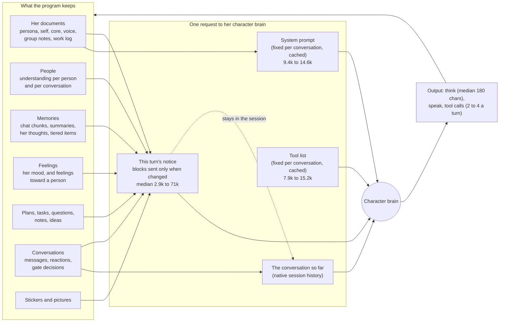
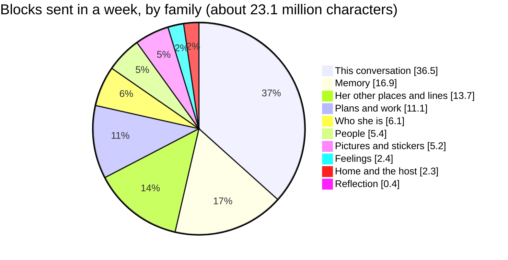
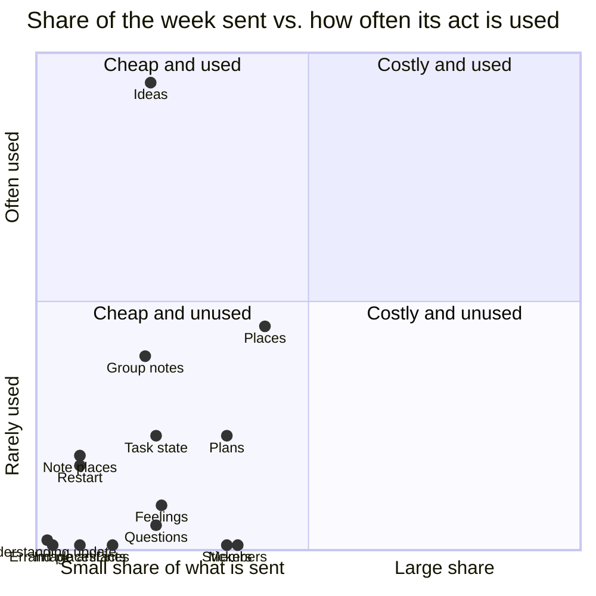

# What she reads in each turn

A map of every block of information the program feeds her character brain in a turn, measured on her real week, with
what each costs and how much it is used. Written for the owner's choice of what to keep, shrink, move or add.

Measured read-only on her live data, the 7 days to 2026-10-21: 2,549 turns. Sizes are characters of the JSON she is
sent (her text is mostly Chinese; tokens depend on the model's tokenizer, so characters are the stable unit). Nothing of
her content was read; only names, counts and lengths.

## How a turn is put together

Three things decide what a turn costs:

- **The system prompt and the tool list** are the same for every turn of a conversation, so the model server keeps them
  in its prompt cache. Home: system prompt 14,609 characters, 21 tools in 15,236. A group: 11,871 and 16 tools in
  10,851. A private chat: 9,400 and 12 tools in 7,850. They cost a cold start once per conversation, then little.
- **The notice** is built fresh each turn from the stores, and the delivery (`context-delivery.js`) leaves out every
  block, history row, memory and thought the session already shows unchanged. What is sent is a fraction of what is
  prepared: in a group turn about 3,900 of 37,700 characters.
- **What is sent stays.** A notice becomes part of the conversation's history and is carried by every later turn
  there until compaction (her character preset compacts at 0.80 of a 262,144-token window). Her reflection turns
  run in a session of their own (ADR-072), so their readings never enter a conversation.

Her output is small next to her input: a thought has a median of 180 characters (90% under 521), her text goes out
through `speak`, and a turn makes 2 to 4 tool calls.

## Turns by kind and place

| Turn kind, where | Turns a week | Prepared (median) | Sent (median) | Calls | Tools listed |
|---|---|---|---|---|---|
| external, group | 1,196 | 37,738 | 3,907 | 3 | 18 |
| external, home: other line | 407 | 47,593 | 6,108 | 2 | 19 |
| external, home: local chat | 150 | 45,306 | 3,364 | 1 | 25 |
| task_feedback, home: other line | 132 | 55,921 | 16,421 | 3 | 19 |
| self_development, home: local chat | 113 | 67,662 | 16,561 | 3 | 25 |
| task_feedback, group | 95 | 45,563 | 11,728 | 4 | 18 |
| note, home: local chat | 83 | 38,203 | 6,981 | 3 | 25 |
| visit, group | 65 | 35,666 | 14,506 | 4 | 18 |
| task_feedback, home: local chat | 58 | 53,505 | 14,557 | 4 | 25 |
| heartbeat, home: local chat | 50 | 63,784 | 26,339 | 3 | 25 |
| note, home: other line | 43 | 44,460 | 9,627 | 2 | 19 |
| scheduled, home: other line | 38 | 56,315 | 20,713 | 3 | 19 |
| consult, group | 38 | 37,039 | 2,850 | 2 | 18 |
| scheduled, home: local chat | 23 | 57,613 | 23,901 | 5 | 25 |
| scheduled, group | 15 | 36,638 | 12,904 | 4 | 18 |
| consult, home: other line | 13 | 49,684 | 10,357 | 2 | 19 |
| consult, home: local chat | 7 | 47,675 | 9,482 | 2 | 25 |
| settlement, home: local chat | 7 | 47,550 | 10,950 | 3 | 25 |
| visit, home: other line | 7 | 37,390 | 17,355 | 4 | 17 |
| heartbeat: self evaluation, home: local chat | 4 | 78,975 | 70,647 | 2 | 25 |
| heartbeat: dice review, home: local chat | 3 | 73,982 | 65,136 | 3 | 25 |
| errand, group | 3 | 38,201 | 5,826 | 4 | 18 |

Prepared is everything built for the turn; sent is what was not already in the session (history rows, memories and
thoughts counted by the rows the delivery left out of each turn). Group conversations are almost half her turns and
the cheapest per turn; hand-backs from the action brain (`task_feedback`) and reflection turns are the largest.

## Where the sent characters go

## Every block

"In turns" is the share of the week's turns that carry it; "Sent" the share of those turns where it changed and was
sent (for history rows, memories and thoughts: the share of rows sent); "Share of the week" its part of all
characters sent. "Its tool used" applies to blocks that exist to support one act: the share of turns carrying the
block in which she made that call (the tool is named; for group notes, a `write_document` to a group's notes). A block
that shapes what she says (memories, feelings, her notes about a group) can matter without any tool call, so a low
rate there is a question, not a verdict.

**This conversation** (36.5% of what is sent)

| Block | In turns | Median chars | Sent (not unchanged) | Share of the week | Its tool used |
|---|---|---|---|---|---|
| `event` | 100% | 169 | 100% | 14.0% | – |
| `group_continuity` | 53% | 1,405 | 97% | 9.4% | – |
| `recent_experience` | 7% | 12,061 | 75% | 6.5% | – |
| `delivered_history` | 100% | 7,538 | 4% | 2.9% | – |
| `clock` | 100% | 104 | 89% | 1.0% | – |
| `pace` | 56% | 157 | 88% | 0.8% | – |
| `recent_thoughts` | 100% | 1,133 | 5% | 0.7% | – |
| `ref_index` | 100% | 42 | 100% | 0.5% | – |
| `scene` | 100% | 24 | 100% | 0.2% | – |
| `recent_phrasing` | 60% | 98 | 29% | 0.2% | – |
| `speak` | 80% | 230 | 7% | 0.1% | – |
| `session_class` | 100% | 8 | 100% | 0.1% | – |
| `media` | 2% | 471 | 82% | 0.1% | – |
| `unsent` | 10% | 32 | 100% | 0.0% | – |
| `attend` | 8% | 38 | 99% | 0.0% | – |
| `called` | 0% | 42 | 38% | 0.0% | – |
| `coverage` | 0% | 31 | 29% | 0.0% | – |

**Memory** (16.9% of what is sent)

| Block | In turns | Median chars | Sent (not unchanged) | Share of the week | Its tool used |
|---|---|---|---|---|---|
| `memories` | 100% | 2,571 | 45% | 16.7% | – |
| `night_list` | 0% | 5,240 | 100% | 0.1% | – |
| `memory_week` | 0% | 1,430 | 100% | 0.0% | – |

**Her other places and lines** (13.7% of what is sent)

| Block | In turns | Median chars | Sent (not unchanged) | Share of the week | Its tool used |
|---|---|---|---|---|---|
| `places` | 5% | 8,288 | 100% | 4.2% | 13.6% of turns (`visit`) |
| `group_notes` | 56% | 2,632 | 14% | 2.0% | 11.8% of turns (`write_document`) |
| `notes` | 92% | 978 | 15% | 1.5% | – |
| `lines` | 45% | 2,296 | 10% | 1.4% | 0.1% of turns (`peer_line`) |
| `elsewhere` | 38% | 664 | 45% | 1.3% | – |
| `notes_sent` | 92% | 885 | 13% | 1.1% | – |
| `note_places` | 97% | 1,249 | 7% | 0.8% | 5.7% of turns (`note`) |
| `note` | 5% | 584 | 100% | 0.4% | – |
| `errand_places` | 27% | 1,348 | 9% | 0.3% | 0.4% of turns (`errand`) |
| `errands` | 27% | 671 | 10% | 0.2% | – |
| `visit` | 3% | 554 | 100% | 0.2% | – |
| `peer_asides` | 5% | 265 | 57% | 0.1% | – |
| `faces` | 57% | 124 | 14% | 0.1% | – |
| `last_visits` | 5% | 380 | 47% | 0.1% | – |
| `notices` | 4% | 102 | 100% | 0.1% | – |
| `your_place` | 56% | 22 | 5% | 0.0% | – |
| `condensed` | 2% | 79 | 100% | 0.0% | – |
| `linked_scenes` | 20% | 195 | 2% | 0.0% | – |
| `errand` | 0% | 157 | 100% | 0.0% | – |
| `muted_here` | 0% | 42 | 100% | 0.0% | – |

**Plans and work** (11.1% of what is sent)

| Block | In turns | Median chars | Sent (not unchanged) | Share of the week | Its tool used |
|---|---|---|---|---|---|
| `plans` | 100% | 264 | 11% | 3.5% | 7.0% of turns (`plan`) |
| `questions` | 41% | 436 | 40% | 2.2% | 1.4% of turns (`ask`) |
| `task_state` | 100% | 562 | 30% | 2.2% | 6.9% of turns (`task`) |
| `ideas` | 4% | 8,688 | 50% | 2.1% | 28.3% of turns (`ideas`) |
| `action_capabilities` | 100% | 879 | 8% | 0.8% | – |
| `scheduled_plan` | 3% | 1,094 | 100% | 0.4% | – |
| `waiting` | 1% | 236 | 40% | 0.0% | – |
| `task_continuation` | 3% | 127 | 5% | 0.0% | – |

**Who she is** (6.1% of what is sent)

| Block | In turns | Median chars | Sent (not unchanged) | Share of the week | Its tool used |
|---|---|---|---|---|---|
| `self_state` | 100% | 6,916 | 7% | 5.6% | – |
| `things` | 100% | 156 | 12% | 0.3% | – |
| `doc_refs` | 100% | 257 | 5% | 0.2% | – |

**People** (5.4% of what is sent)

| Block | In turns | Median chars | Sent (not unchanged) | Share of the week | Its tool used |
|---|---|---|---|---|---|
| `members` | 56% | 4,020 | 13% | 3.7% | 0.1% of turns (`find_member`) |
| `relationship` | 84% | 1,600 | 7% | 1.2% | – |
| `understanding_update` | 84% | 530 | 4% | 0.2% | 0.6% of turns (`understand_person`) |
| `speaker` | 100% | 14 | 100% | 0.2% | – |
| `people` | 7% | 402 | 22% | 0.1% | – |
| `sender_identity` | 48% | 51 | 15% | 0.0% | – |
| `relationship_shared` | 1% | 108 | 12% | 0.0% | – |

**Pictures and stickers** (5.2% of what is sent)

| Block | In turns | Median chars | Sent (not unchanged) | Share of the week | Its tool used |
|---|---|---|---|---|---|
| `stickers` | 100% | 3,973 | 8% | 3.5% | 0.2% of turns (`sticker`) |
| `image_artifacts` | 44% | 1,555 | 11% | 0.8% | 0.0% of turns (`attach_image`) |
| `sticker_candidates` | 42% | 614 | 27% | 0.7% | 0.4% of turns (`sticker`) |
| `your_pictures` | 31% | 596 | 7% | 0.1% | – |
| `stickers_review` | 0% | 580 | 100% | 0.0% | – |

**Feelings** (2.4% of what is sent)

| Block | In turns | Median chars | Sent (not unchanged) | Share of the week | Its tool used |
|---|---|---|---|---|---|
| `affect` | 100% | 244 | 17% | 2.3% | 2.7% of turns (`feel`) |
| `how_to_record` | 100% | 215 | 4% | 0.1% | – |

The mood is one paragraph (ADR-086): rendered on her ledger, about 40 characters in a group and in the relevance gate,
nothing at the calm bands (不错, 平静), and about 1,375 characters at home with its reasons list. (The table's turns read
its earlier form; see the changelog.) Feelings toward a person are
shown with that person (`relationship` in a one-to-one conversation, `people` in a group), and an addressed turn
carries `called`, one fixed line sent once per session.

**Home and the host** (2.3% of what is sent)

| Block | In turns | Median chars | Sent (not unchanged) | Share of the week | Its tool used |
|---|---|---|---|---|---|
| `undelivered_outbound_not_public` | 100% | 2 | 10% | 1.2% | – |
| `restart` | 45% | 1,125 | 15% | 0.8% | 5.0% of turns (`restart`) |
| `rhythm` | 45% | 119 | 32% | 0.2% | – |
| `credentials` | 34% | 281 | 5% | 0.0% | – |
| `host` | 21% | 180 | 7% | 0.0% | – |
| `switches` | 7% | 232 | 8% | 0.0% | 3.3% of turns (`set_policy`) |

**Reflection** (0.4% of what is sent; these turns run in their own session)

| Block | In turns | Median chars | Sent (not unchanged) | Share of the week | Its tool used |
|---|---|---|---|---|---|
| `night` | 1% | 1,628 | 100% | 0.2% | – |
| `self_review` | 0% | 3,700 | 100% | 0.1% | – |
| `dice_review` | 0% | 4,757 | 100% | 0.1% | – |
| `map` | 0% | 5,501 | 100% | 0.1% | – |
| `tools_week` | 0% | 2,983 | 100% | 0.0% | – |
| `settlement` | 0% | 188 | 100% | 0.0% | – |
| `cared` | 0% | 1,127 | 100% | 0.0% | – |
| `ongoing_development_task_id` | 1% | 39 | 82% | 0.0% | – |

## Cost against use, for the blocks that serve one act

(x: the block's share of the week, scaled so 10% is the right edge; y: its act used in that share of turns, scaled so
30% is the top.)

## What the measurement shows

1. **The action brain's hand-back reports are the largest single cost.** A `task_feedback` turn carries the report in
   its `event` (`trusted_context_events`): a median of 9,148 characters, 2.5 million in the week, about 11% of
   everything she is sent. The trigger is always sent, so a report is never left out as unchanged.
2. **Memories are the largest family that changes every turn** (16.7%): about 2,600 characters retrieved per turn,
   45% new to the session. They are used: a memory shown to her shares a run of six characters with what she then
   says 8.9% of the time, against 1.8% for a memory from another turn (chance; measured 2026-10-16). That measure
   cannot rank kinds of memory (it favours text written to be quoted), and a memory used rarely can carry weight.
3. **The conversation's own catch-up** (`group_continuity`, 9.4%) and **recent experience** at home (6.5%, 12,000
   characters in 7% of turns) are the next largest; both are sent almost every time they are carried.
4. **The sticker list is costly and almost unused.** It is in every turn (a group's list holds 50 stickers, about 4,000
   characters), 3.5% of the week, and she sends a sticker in 0.2% of those turns.
5. **The member list** (29 recently active members and the group's admins, 3.7% of the week) is used for
   `find_member` in 0.1% of group turns; mentions written into speech are not counted here.
6. **Places pay for themselves:** the list of places is 4.2% of the week, carried only in 5% of turns, and she visits
   in 13.6% of them. Her ideas notebook (2.1%) is acted on in 28% of the turns that carry it.
7. **Blocks that change rarely cost little:** her self state (6,916 characters) is in every turn and sent in 7% of
   them; the delivery's leave-out-when-unchanged is doing its work.

## Choices, with what each would change

Each is the owner's to pick; each states what it saves and what it costs her. "Saves" is of the week's sent characters.

| # | Change | Saves | Costs her |
|---|---|---|---|
| A | A hand-back carries a shorter first page of the report (what was done, the result, where the rest is; about 2,000 characters), the rest by paging | about 8% | one more read when she wants the detail |
| B | A group's sticker list shows only the stickers that group has seen her use, with the shelf on asking | up to about 3% | a sticker she has not used there needs `sticker` `do: shelf` first |

The budgets this works within: the system prompt and the tool list stay fixed per conversation (cache-first,
`maximize-cache-hit-by-design.md`); everything a turn sends stays in that conversation until compaction; her output is
small, so the cost of a turn is almost all input, and most of the input is the notice.

## How it was measured

The `turn.output` audit record names the blocks a turn left out as unchanged and counts the history rows, memories and
thoughts left out; the episode keeps the prepared context. Sizes are `len(json.dumps(block, ensure_ascii=False))`. A
block's act comes from the turn's recorded calls (tool names; for a document, the document named in the call's
result). The system prompt is `render.render_system` per place, the tool list `role_tools.toolbox` per kind of
conversation. Script: `.runtime/private/articles/measure_week.py` (local, read-only).

## Changelog

- **2026-10-21** — Re-measured on the week to 2026-10-21 (2,549 turns); every number above replaced. Added the blocks
  the code builds now: `people` (ADR-082), `called` (ADR-086), `map` (ADR-073), `switches` (ADR-052), and `tools_week` and
  `cared` in her weekly self review; `affect` described in its ADR-086 form (one paragraph, nothing at the calm bands, feelings
  toward a person with that person; the relevance gate reads the same paragraph). Compaction threshold corrected to
  her preset's 0.80. "Its tool used" now counts a named act per block (the 2026-10-16 column counted mentions with
  `find_member`). New findings: hand-back reports in `event`; the sticker list in groups. Choices A and B new.
- **2026-10-16** — Choices A, B and C built (afd9e001): at home the whole sticker shelf only in the turns that tidy
  it, its names otherwise, and `sticker` `do: shelf` lists it on asking; the member list at the most recently active
  members; the understanding offer's explanation once in the system prompt. Choice D measured (memory echo 8.9%
  against 1.8% chance; it cannot rank kinds of memory, her point; both remedies for that measure are hers). Choice E
  became ADR-073, the reflection map, built the same day with ADR-072 (reflection in a session of its own).
- **2026-10-16** — First written, measured on the week to 2026-10-16 (2,775 turns), with choices A to E.
