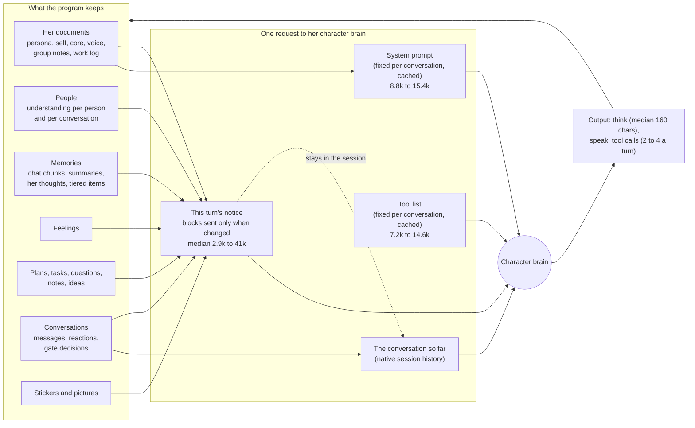
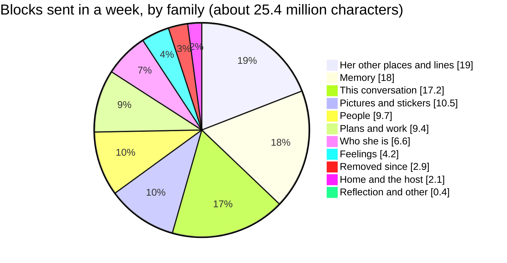
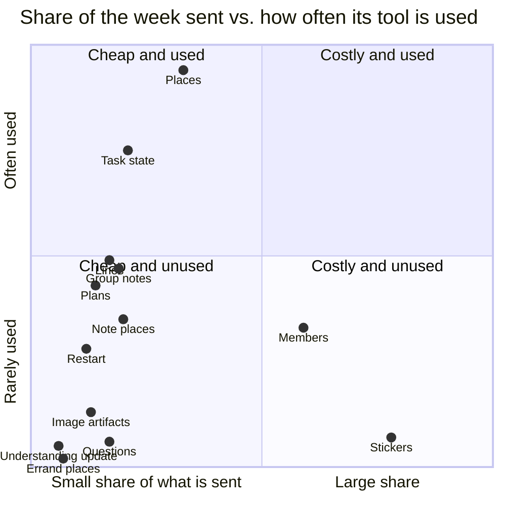

# What she reads in each turn

A map of every block of information the program feeds her character brain in a turn, measured on her real week, with
what each costs and how much it is used. Written for the owner's choice of what to keep, shrink, move or add.

Measured read-only on her live data, the 7 days to 2026-10-16: 2,775 turns. Sizes are characters of the JSON she is
sent (her text is mostly Chinese; tokens depend on the model's tokenizer, so characters are the stable unit). Nothing of
her content was read; only names, counts and lengths.

## How a turn is put together

Three things decide what a turn costs:

- **The system prompt and the tool list** are the same for every turn of a conversation, so the model server keeps them
  in its prompt cache. Home: system prompt 15,376 characters, 21 tools in 14,623. A group: 12,388 and 18 tools in
  11,031. A private chat: 8,786 and 12 tools in 7,211. They cost a cold start once per conversation, then little.
- **The notice** is built fresh each turn from the stores, and the delivery (`context-delivery.js`) leaves out every
  block, history row, memory and thought the session already shows unchanged. What is sent is a fraction of what is
  prepared: in a group turn about 5,600 of 35,000 characters.
- **What is sent stays.** A notice becomes part of the conversation's history and is carried by every later turn
  there until compaction (at 0.75 of 262,144 tokens). This is why ADR-072 moved the reflection readings into a session
  of their own.

Her output is small next to her input: a thought has a median of 160 characters (90% under 324), her text goes out
through `speak`, and a turn makes 2 to 4 tool calls.

## Turns by kind and place

| Turn kind, where | Turns a week | Prepared (median) | Sent (median) | Calls | Tools listed |
|---|---|---|---|---|---|
| external, group | 989 | 35,149 | 5,591 | 3 | 19 |
| external, home: other line | 610 | 41,714 | 8,364 | 2 | 24 |
| external, home: local chat | 303 | 45,009 | 6,874 | 2 | 25 |
| task_feedback, home: other line | 150 | 46,190 | 16,896 | 3 | 20 |
| task_feedback, home: local chat | 126 | 46,539 | 19,276 | 3 | 25 |
| self_development, home: local chat | 93 | 46,854 | 23,211 | 4 | 25 |
| visit, group | 88 | 32,450 | 16,186 | 3 | 20 |
| task_feedback, group | 78 | 43,618 | 12,630 | 3 | 19 |
| heartbeat, home: local chat | 73 | 46,486 | 26,525 | 3 | 25 |
| note, home: local chat | 69 | 39,209 | 9,802 | 4 | 25 |
| note, home: other line | 44 | 39,928 | 11,193 | 3 | 21 |
| scheduled, home: local chat | 42 | 46,183 | 22,665 | 3 | 26 |
| consult, group | 37 | 36,981 | 2,850 | 2 | 18 |
| scheduled, home: other line | 31 | 51,664 | 19,043 | 3 | 19 |
| scheduled, group | 10 | 34,739 | 10,732 | 3 | 19 |
| consult, home: other line | 8 | 48,662 | 10,489 | 2 | 19 |
| settlement, home: local chat | 7 | 43,951 | 24,602 | 4 | 25 |
| consult, home: local chat | 7 | 45,128 | 11,680 | 2 | 30 |
| heartbeat: self evaluation, home: local chat | 6 | 70,839 | 29,892 | 3 | 25 |
| heartbeat: dice review, home: local chat | 3 | 69,108 | 41,375 | 3 | 25 |
| errand, group | 1 | 38,201 | 5,826 | 3 | 18 |

Prepared is everything built for the turn; sent is what was not already in the session (history rows, memories and
thoughts counted at their measured rates: history 0%, memories 53%, thoughts 24%). Group conversations are half her
turns and the cheapest per turn; reflection turns (self evaluation, dice review) are the largest, which ADR-072 now
keeps out of her home conversation.

## Where the sent characters go

## Every block

"In turns" is the share of the week's turns that carry it; "Sent" the share of those turns where it changed and was
sent; "Share of the week" its part of all characters sent. "Its tool used" applies to blocks that exist to support one
tool (the sticker shelf for `sticker`, places for `visit`, and so on): the share of turns carrying the block in which
she used that tool. A block that shapes what she says (memories, feelings, her notes about a group) can matter without
any tool call, so a low rate there is a question, not a verdict.

**Who she is** (6.6% of what is sent)

| Block | In turns | Median chars | Sent (not unchanged) | Share of the week | Its tool used |
|---|---|---|---|---|---|
| `self_state` | 100% | 3,666 | 16% | 6.4% | – |
| `doc_refs` | 55% | 257 | 6% | 0.1% | 16.7% of turns |
| `things` | 43% | 155 | 11% | 0.1% | – |

**People** (9.7% of what is sent)

| Block | In turns | Median chars | Sent (not unchanged) | Share of the week | Its tool used |
|---|---|---|---|---|---|
| `members` | 43% | 4,020 | 31% | 5.9% | 6.5% of turns |
| `relationship` | 92% | 1,579 | 19% | 3.0% | – |
| `understanding_update` | 92% | 531 | 11% | 0.6% | 1.0% of turns |
| `speaker` | 100% | 14 | 100% | 0.2% | – |
| `sender_identity` | 36% | 58 | 19% | 0.0% | – |
| `relationship_shared` | 0% | 108 | 17% | 0.0% | – |

**This conversation** (17.2% of what is sent)

| Block | In turns | Median chars | Sent (not unchanged) | Share of the week | Its tool used |
|---|---|---|---|---|---|
| `group_continuity` | 39% | 1,564 | 96% | 6.5% | – |
| `recent_experience` | 6% | 5,227 | 81% | 2.9% | – |
| `recent_thoughts` | 99% | 1,002 | 24% | 2.6% | – |
| `event` | 100% | 191 | 100% | 2.1% | – |
| `clock` | 100% | 107 | 91% | 1.1% | – |
| `pace` | 43% | 158 | 89% | 0.7% | – |
| `ref_index` | 100% | 42 | 100% | 0.5% | – |
| `recent_phrasing` | 74% | 94 | 32% | 0.2% | – |
| `speak` | 73% | 246 | 11% | 0.2% | – |
| `scene` | 100% | 17 | 100% | 0.2% | – |
| `session_class` | 100% | 15 | 100% | 0.2% | – |
| `media` | 1% | 472 | 100% | 0.1% | – |
| `unsent` | 2% | 23 | 100% | 0.0% | – |
| `delivered_history` | 100% | 5,690 | 0% | 0.0% | – |

**Memory** (18.0% of what is sent)

| Block | In turns | Median chars | Sent (not unchanged) | Share of the week | Its tool used |
|---|---|---|---|---|---|
| `memories` | 100% | 3,018 | 53% | 17.5% | 2.5% of turns |
| `memory_source_rules` | 38% | 556 | 20% | 0.5% | – |
| `night_list` | 0% | 2,298 | 100% | 0.0% | – |
| `memory_week` | 0% | 1,430 | 100% | 0.0% | – |

**Feelings** (4.2% of what is sent)

| Block | In turns | Median chars | Sent (not unchanged) | Share of the week | Its tool used |
|---|---|---|---|---|---|
| `affect` | 100% | 1,441 | 25% | 3.9% | 2.9% of turns |
| `how_to_record` | 100% | 215 | 12% | 0.3% | – |

**Her other places and lines** (19.0% of what is sent)

| Block | In turns | Median chars | Sent (not unchanged) | Share of the week | Its tool used |
|---|---|---|---|---|---|
| `notes` | 88% | 969 | 35% | 3.3% | – |
| `places` | 5% | 5,334 | 100% | 3.3% | 18.7% of turns |
| `notes_sent` | 89% | 878 | 32% | 2.8% | – |
| `elsewhere` | 50% | 576 | 68% | 2.2% | – |
| `note_places` | 97% | 1,183 | 16% | 2.0% | 6.9% of turns |
| `group_notes` | 43% | 2,500 | 16% | 1.9% | 9.3% of turns |
| `lines` | 56% | 1,231 | 22% | 1.7% | 9.7% of turns |
| `errand_places` | 34% | 1,158 | 17% | 0.7% | 0.3% of turns |
| `note` | 4% | 570 | 100% | 0.3% | – |
| `peer_asides` | 3% | 697 | 80% | 0.2% | – |
| `errands` | 23% | 320 | 19% | 0.2% | – |
| `last_visits` | 5% | 348 | 71% | 0.2% | – |
| `visit` | 3% | 406 | 100% | 0.1% | – |
| `faces` | 44% | 119 | 18% | 0.1% | – |
| `notes_review` | 0% | 7,740 | 100% | 0.1% | – |
| `linked_scenes` | 26% | 195 | 14% | 0.1% | – |
| `condensed` | 1% | 79 | 100% | 0.0% | – |
| `your_place` | 43% | 22 | 10% | 0.0% | – |
| `notices` | 1% | 85 | 100% | 0.0% | – |
| `errand` | 0% | 156 | 100% | 0.0% | – |
| `muted_here` | 0% | 42 | 100% | 0.0% | – |

**Plans and work** (9.4% of what is sent)

| Block | In turns | Median chars | Sent (not unchanged) | Share of the week | Its tool used |
|---|---|---|---|---|---|
| `ideas` | 3% | 8,357 | 80% | 2.4% | – |
| `task_state` | 100% | 508 | 37% | 2.1% | 15.0% of turns |
| `questions` | 20% | 1,823 | 40% | 1.7% | 1.2% of turns |
| `action_capabilities` | 100% | 887 | 16% | 1.5% | – |
| `plans` | 100% | 589 | 21% | 1.4% | 8.5% of turns |
| `scheduled_plan` | 2% | 916 | 100% | 0.3% | – |
| `waiting` | 1% | 185 | 65% | 0.0% | – |
| `task_continuation` | 0% | 127 | 8% | 0.0% | – |

**Pictures and stickers** (10.5% of what is sent)

| Block | In turns | Median chars | Sent (not unchanged) | Share of the week | Its tool used |
|---|---|---|---|---|---|
| `stickers` | 99% | 3,974 | 18% | 7.8% | 1.3% of turns |
| `image_artifacts` | 44% | 1,555 | 17% | 1.3% | 2.5% of turns |
| `your_pictures` | 55% | 496 | 27% | 0.8% | 2.1% of turns |
| `sticker_candidates` | 33% | 602 | 29% | 0.6% | 0.9% of turns |
| `stickers_review` | 0% | 588 | 100% | 0.0% | – |

**Home and the host** (2.1% of what is sent)

| Block | In turns | Median chars | Sent (not unchanged) | Share of the week | Its tool used |
|---|---|---|---|---|---|
| `restart` | 49% | 1,027 | 21% | 1.2% | 5.6% of turns |
| `rhythm` | 56% | 126 | 72% | 0.6% | – |
| `credentials` | 46% | 281 | 16% | 0.2% | 0.0% of turns |
| `host` | 40% | 180 | 16% | 0.1% | – |
| `undelivered_outbound_not_public` | 100% | 2 | 18% | 0.0% | – |

**Reflection** (0.2% of what is sent)

| Block | In turns | Median chars | Sent (not unchanged) | Share of the week | Its tool used |
|---|---|---|---|---|---|
| `night` | 0% | 1,583 | 100% | 0.1% | – |
| `self_review` | 0% | 2,322 | 100% | 0.1% | – |
| `dice_review` | 0% | 3,410 | 100% | 0.0% | – |
| `settlement` | 0% | 188 | 100% | 0.0% | – |
| `ongoing_development_task_id` | 0% | 39 | 75% | 0.0% | – |
| `coverage` | 0% | 31 | 33% | 0.0% | – |

**Removed since (older turns of the week)** (2.9% of what is sent)

| Block | In turns | Median chars | Sent (not unchanged) | Share of the week | Its tool used |
|---|---|---|---|---|---|
| `developer_inbox` | 34% | 1,067 | 51% | 2.1% | 0.0% of turns |
| `schedule_control` | 63% | 719 | 17% | 0.8% | 11.1% of turns |

**Other** (0.2% of what is sent)

| Block | In turns | Median chars | Sent (not unchanged) | Share of the week | Its tool used |
|---|---|---|---|---|---|
| `trimmed` | 13% | 113 | 86% | 0.1% | – |
| `attend` | 4% | 35 | 99% | 0.0% | – |

## Cost against use, for the blocks that serve one tool

(x: the block's share of the week, scaled so 10% is the right edge; y: its tool used in that share of turns, scaled so
20% is the top.)

## What the measurement found

1. **The sticker shelf is the single most costly block for what it does.** In groups it lists 11 stickers (741
   characters); in home turns it lists her whole shelf, 46 stickers in 5,700 characters, there so she can tidy it. Home
   turns are half her week, so the shelf is 7.8% of everything sent, and the sticker tool is used in 1.3% of the turns
   that carry it.
2. **The member list** in a group turn holds the 51 most recent members (3,700 characters), 5.9% of the week, used for
   `find_member` or a mention in 6.5% of group turns.
3. **Memories are the largest family that changes every turn** (17.5%): about 3,000 characters retrieved per turn, half
   new to the session. Whether she uses them cannot be read from tool calls; it needs its own measure (how often a
   retrieved memory is cited or shapes what she says) before anything changes.
4. **Some blocks are carried everywhere for a rare act**: the places an errand can go (1,158 characters in 34% of
   turns, 3 errands in the week), the offer to update someone's understanding (531 characters in 92% of turns, used in
   1%).
5. **Her group notes, 47,000 characters across 16 groups and her most active store this week (167 revisions)**, reach a
   home turn only as up to eight headings per group. Inside a group the notes come whole (2,500 characters, 1.9% of the
   week), and she acts on them in 9.3% of those turns.
6. **Blocks that change rarely cost little**: her self state (3,666 characters) is in every turn and sent in 16% of
   them; the delivery's leave-out-when-unchanged is doing its work.
7. **Two blocks in older turns of the week no longer exist** (`schedule_control`, `developer_inbox`): 2.9% of the week
   is already gone.

## Choices, with what each would change

Each is the owner's to pick; each states what it saves and what it costs her. "Saves" is of the week's sent characters.

| # | Change | Saves | Costs her |
|---|---|---|---|
| A | The sticker shelf at home only in the turns that tidy it (reflection, self-development); other home turns list none | about 6% | at home she sends a sticker by name only when she remembers it, or asks `sticker` for the shelf |
| B | The member list at the 20 most recent members, not 51 | about 3% | someone quieter needs `find_member` before a mention |
| C | Errand places and the understanding offer as one line each ("you can…, list with …") instead of the full lists | about 1% | one call to list them when she wants them |
| D | Measure memory use (cited or echoed) before touching memories | none yet | none |
| E | The reflection map (ADR-072's session): one line per store with its size, what changed since her last reflection and how to open it, plus what she changed in full (group-note sections, document changes with her reasons, person-level understandings) | adds only in reflection turns | nothing in regular turns |

The budgets this works within: the system prompt and the tool list stay fixed per conversation (cache-first,
`maximize-cache-hit-by-design.md`); everything a turn sends stays in that conversation until compaction; her output is
small, so the cost of a turn is almost all input, and most of the input is the notice.

## How it was measured

The `turn.output` audit record names the blocks a turn left out as unchanged and counts the history rows, memories and
thoughts left out; the episode keeps the prepared context. Sizes are `len(json.dumps(block, ensure_ascii=False))`.
Tool use comes from the turn's recorded calls (`speak` parts by kind). The system prompt is `render.render_system` per
place, the tool list `role_tools.toolbox` per kind of conversation. The week includes code from before ADR-061's and the
second wording audit's removals; those blocks are listed apart.

## Since this was measured (2026-10-16)

- **A, B and C are built** (afd9e001). At home, where a sticker cannot be sent, the whole shelf comes in the turns that
  tidy it and its names otherwise (her answer: the names are hers and what she remembers them by), and `sticker` `do:
  shelf` lists it whole on asking. The member list holds the 20 most recently active. The understanding offer's long
  explanation is said once in her system prompt instead of in 92% of turns. Errand places were already shown only
  where she can send one, so they stay.
- **D, memory use, measured.** A memory shown to her shares a run of six characters with what she then says 8.9% of
  the time, against 1.8% for a memory from another turn (chance), and in a quarter of her turns she echoes at least one
  (a lower bound: paraphrase and what only informs are not counted). By kind: raw chat chunks are 71% of what is shown
  and echo least (6.2%); conversation summaries 17.7%; her own past thoughts 10.2%; items of her documents 36 to 46%.
  Memories are used. The kinds cannot be ranked with this measure (her point): a six-character overlap favours text
  written to be quoted, as her document items are, over text she rewrites when she uses it, as chat chunks are, so a
  low rate for chunks does not mean they are not used. Setting the mix would need a comparison within one kind, or a
  measure of use that does not depend on wording. Her caution: a memory used rarely can carry
  weight (one she uses once a day anchors a daily account), so a change would weigh what a memory holds up, not only
  how often it is echoed.
- **E** is ADR-073, proposed for her review.
